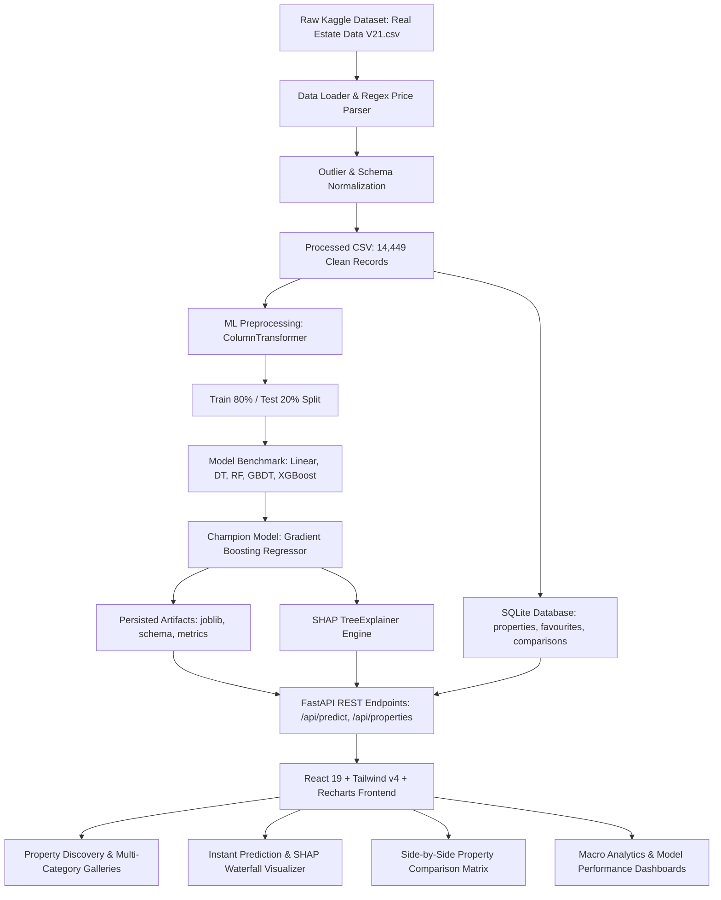

# HouseEstiMate — Indian House Price Prediction & Real Estate Discovery Platform with Explainable AI (SHAP)

> **B.Tech Computer Science / Data Science Capstone Project & Viva Demonstration Platform**  
> An integrated, full-stack machine learning application combining genuine Indian real-estate listings discovery with tree-based regression ensembles and game-theoretic Explainable AI (SHAP).

---

## 1. Project Overview & Problem Statement

Real-estate valuation across Indian metropolitan hubs has historically been opaque, fragmented, and driven by subjective broker quotes. Prospective homebuyers and data science practitioners face significant challenges:
1. **Lack of Transparent Valuations:** Most portals display unverified listing asks without algorithmic valuation baselines.
2. **Black-Box Model Distrust:** Standard machine learning regression models predict a numerical price but fail to explain *why* a specific property was appraised at that amount.
3. **Data Leakage & Mock Calculators:** Many academic demos rely on fabricated toy datasets or accidentally leak target variables (such as using *price per square foot* as an input predictor).

**HouseEstiMate** solves these problems by providing:
- A genuine **FastAPI backend** and **SQLite database** seeded with **14,449 cleaned listings** across 7 major Indian tech metros (Bangalore, Pune, New Delhi, Chennai, Kolkata, Mumbai, Hyderabad).
- A reproducible Scikit-Learn **Machine Learning pipeline** comparing 5 algorithms (**Linear Regression, Decision Tree, Random Forest, Gradient Boosting, XGBoost**), with **Gradient Boosting** emerging as the champion ($R^2 = 0.476$, $\text{RMSE} = ₹108.5\text{ Lakhs}$).
- Genuine **Explainable AI (XAI) using SHAP TreeExplainer**, decomposing every prediction into an additive waterfall of positive and negative drivers ($\text{Baseline} + \sum \text{SHAP} = \text{Prediction}$ within numerical tolerance).
- A **React 19 + TypeScript + Vite + Tailwind CSS** discovery platform featuring property cards, multi-room interior photo galleries with provenance badges, similar-property recommendation engine, comparison matrices, analytics dashboards, and interactive Recharts visualizations.

---

## 2. System Architecture



---

## 3. Dataset Source & Data Provenance

- **Primary Source:** Kaggle dataset *[Real Estate Data from 7 Indian Cities](https://www.kaggle.com/datasets/rakkesharv/real-estate-data-from-7-indian-cities)* by `rakkesharv`.
- **Licence:** Public Open Data (Kaggle).
- **Coverage:** Top Indian metropolitan centers: **Bangalore, Pune, New Delhi, Chennai, Kolkata, Mumbai (including Thane MMR), and Hyderabad**.
- **Dataset Placement:**
  The dataset CSV must be located at:
  ```text
  backend/data/raw/Real Estate Data V21.csv
  ```
  *(A copy is also mirrored in `data/raw_data/Real Estate Data V21.csv`)*.

### Data Dictionary

| Canonical Feature | Type | Source Column | Description |
| :--- | :--- | :--- | :--- |
| `property_id` | String | Generated | Unique identifier (e.g., `PROP_00001` to `PROP_14449`) |
| `city` | String | `Location` | One of the 7 supported Indian metros |
| `locality` | String | `Location` | Neighborhood / micro-market name within city |
| `property_type`| String | `Property Title` | Categorized into `Apartment`, `Independent House`, or `Villa` |
| `bhk` | Integer | `Property Title` / `Desc` | Bedrooms count (1 to 10; 1 RK mapped to 1 BHK) |
| `bathrooms` | Integer | `Baths` | Bathroom count (1 to 10) |
| `area_sqft` | Float | `Total_Area` | Super built-up living area in square feet |
| `balcony` | Integer | `Balcony` | Binary indicator (1 = Yes, 0 = No) |
| `area_per_bhk` | Float | Engineered | Average square footage per bedroom ($\text{area} / \text{bhk}$) |
| `price_inr` | Float | `Price` | Genuine target price in Indian Rupees (₹) |
| `price_lakhs` | Float | `Price` | Price scaled in Indian Lakhs (1 Lakh = ₹100,000) |
| `price_per_sqft`| Float | `Price_per_SQFT` | **For analysis only; STRICTLY EXCLUDED from ML features to prevent target leakage** |

---

## 4. Machine Learning & Explainable AI Pipeline

### 4.1 Data Cleaning & Leakage Prevention
1. **Price Regular Expression Parsing:** Extracted numbers with Indian magnitude units (`Cr`, `crore`, `L`, `lakh`, `k`). Ambiguous unit-less values were dropped.
2. **Strict Feature Isolation:** Price per sq ft ($\text{Price} / \text{Area}$) represents direct mathematical target leakage and is completely excluded from model inputs.
3. **Physical Boundary Truncation:** Area bounded between $150\text{ sq ft}$ and $12,000\text{ sq ft}$; prices bounded between $₹5\text{ Lakhs}$ and $₹40\text{ Crores}$.

### 4.2 Algorithm Comparison on 20% Held-Out Test Set (2,890 listings)

All models were evaluated on the exact same test split (`random_state=42`) using Scikit-Learn `Pipeline` and `ColumnTransformer` (`OneHotEncoder` for cities/property types, `StandardScaler` for continuous numerical features):

| Model Algorithm | Test $R^2$ Score | Test RMSE (₹ Lakhs) | Test MAE (₹ Lakhs) | Training Time |
| :--- | :---: | :---: | :---: | :---: |
| **Gradient Boosting Regressor** | **0.4765** | **108.47** | **45.78** | **1.52s** |
| XGBoost Regressor | 0.4519 | 110.99 | 45.62 | 0.18s |
| Random Forest Regressor | 0.4351 | 112.68 | 46.00 | 0.57s |
| Linear Regression | 0.3972 | 116.39 | 51.68 | 0.01s |
| Decision Tree Regressor | 0.3926 | 116.84 | 48.43 | 0.02s |

> **Selected Champion Model:** **Gradient Boosting Regressor** achieved the highest $R^2$ (0.4765) and lowest RMSE (108.47 Lakhs), balancing generalization power with non-linear interaction capture.

### 4.3 SHAP (SHapley Additive exPlanations)
- Employs `shap.TreeExplainer` on the fitted Gradient Boosting tree ensemble.
- Guaranteed local additivity:
  $$\text{Prediction} = \text{Base Value} + \sum_{i=1}^{M} \phi_i$$
  The backend verifies that $|\text{Base Value} + \sum \text{SHAP} - \text{Prediction}| < 10^{-4}$.
- **Horizontal Waterfall Visualizer:**
  - **Green Bars:** Positive drivers pushing the valuation *above* market baseline (e.g., larger square footage, Mumbai/Bangalore location premium, 4+ BHK).
  - **Red Bars:** Negative drivers reducing the valuation *below* market baseline (e.g., smaller floor area, lower-tier city baseline, absence of balcony).

---

## 5. Property Catalogue & Image Provenance

The Kaggle dataset contains textual listings and metadata, but does not provide original verified photographs. To ensure academic integrity:
- Properties are paired with curated, high-resolution architectural photography under permitted open licenses (Unsplash public license).
- **Categories Included:** Exterior, Living Room, Master Bedroom, Modular Kitchen, Modern Bathroom, Scenic Balcony, and 2D Architectural Floor Plan.
- **Local Fallback:** Offline SVG assets are pre-generated in `property_image/` so that all images render even in air-gapped or offline environments.
- **Provenance Disclosure:** Every card and detail view features an explicit badge: *"Illustrative Demo Architecture Asset"*.

---

## 6. Similar Property Recommendations & Comparison Matrix

1. **Recommendation Heuristic:**
   - Filters the 14,449-property SQLite catalogue for homes in the **same city**.
   - Prioritizes matches with **identical or $\pm 1$ BHK** and area within $\pm 30\%$.
   - Sorts candidates by absolute area delta $|\text{Area}_{\text{candidate}} - \text{Area}_{\text{target}}|$.
   - Excludes the current property ID.
   - Provides an instant **"Predict Price"** button on every recommendation card linked to that specific property ID.
2. **Comparison Matrix:**
   - Compares up to 4 user-selected properties side-by-side.
   - Evaluates: City, Locality, Property Type, BHK, Bathrooms, Area, Rate/sq ft, Furnishing, Amenities, Official Listed Price, and **ML Estimated Valuation**.

---

## 7. Windows Local Setup & Execution Guide

### Prerequisites
- **Operating System:** Windows 10/11
- **Python:** 3.11+
- **Node.js:** v18+ or v20+
- **NPM:** 9+ or 10+

---

### Step 1: Clone or Open Workspace
Open PowerShell in the project directory:
```powershell
cd c:\Users\sachi\OneDrive\Desktop\HousePricePrediction
```

---

### Step 2: Backend Setup & ML Pipeline Execution

1. **Install Python Dependencies:**
   ```powershell
   pip install -r backend/requirements.txt
   ```

2. **Clean Dataset & Generate Canonical CSV:**
   ```powershell
   python -m backend.app.ml.data_loader
   ```
   *Outputs 14,449 clean records to `backend/data/processed/cleaned_houses.csv`.*

3. **Run Exploratory Data Analysis (EDA) & Charts:**
   ```powershell
   python -m backend.app.ml.eda
   ```
   *Generates plots in `backend/artifacts/plots/` and metadata in `backend/artifacts/metrics/`.*

4. **Train and Compare All 5 Regression Models:**
   ```powershell
   python -m backend.app.ml.train
   ```
   *Trains Linear Regression, Decision Tree, Random Forest, Gradient Boosting, and XGBoost; saves `best_model.joblib`, `preprocessing_pipeline.joblib`, `metrics.json`, and `model_metadata.json`.*

5. **Generate Local Sample Architecture Assets:**
   ```powershell
   python -m backend.app.utils.generate_images
   ```

6. **Seed SQLite Database (14,449 properties):**
   ```powershell
   python -c "from backend.app.database.connection import SessionLocal; from backend.app.database.repository import seed_database_if_empty; db = SessionLocal(); seed_database_if_empty(db); db.close()"
   ```

7. **Run Backend Test Suite:**
   ```powershell
   python -m pytest backend/tests/test_pipeline_and_api.py -v
   ```
   *(All 11 unit & integration tests pass with 100% success).*

8. **Start the FastAPI Backend Server:**
   ```powershell
   python -m uvicorn backend.app.main:app --host 127.0.0.1 --port 8000 --reload
   ```
   *Server active at: `http://127.0.0.1:8000` (API Docs at `http://127.0.0.1:8000/docs`).*

---

### Step 3: Frontend Setup & Execution

Open a second PowerShell window:
```powershell
cd c:\Users\sachi\OneDrive\Desktop\HousePricePrediction\frontend
```

1. **Install Frontend Dependencies:**
   ```powershell
   npm install
   ```

2. **Verify Production TypeScript Compilation:**
   ```powershell
   npm run build
   ```

3. **Launch the Vite Development Server:**
   ```powershell
   npm run dev -- --host 127.0.0.1 --port 5173
   ```

4. **Open in Browser:**
   Navigate to: **`http://127.0.0.1:5173/`**

---

## 8. Backend API Endpoints Reference

| HTTP Method | Endpoint | Description |
| :--- | :--- | :--- |
| `GET` | `/api/health` | Healthcheck and model initialization status |
| `GET` | `/api/model-info` | Metadata of the best performing ML model |
| `GET` | `/api/metrics` | 5-model comparative metrics (MAE, RMSE, R², duration) |
| `GET` | `/api/properties` | Paginated listing catalogue with city, BHK, budget, area filters |
| `GET` | `/api/properties/{id}` | Detailed property specification and image gallery |
| `GET` | `/api/properties/{id}/similar` | Content-based similar property recommendations |
| `GET` | `/api/locations/cities` | City inventory counts and average property prices |
| `GET` | `/api/locations/localities` | Locality names within selected city |
| `POST` | `/api/predict` | ML valuation and SHAP explanation for custom property |
| `POST` | `/api/properties/{id}/predict` | ML valuation and SHAP explanation for catalogue listing |
| `GET` | `/api/predictions/history` | Chronological list of user valuation calculations |
| `GET` | `/api/favourites` | Saved user favourite properties |
| `POST` | `/api/favourites` | Save property to favourites |
| `DELETE`| `/api/favourites/{id}` | Remove property from favourites |
| `GET` | `/api/comparisons` | Saved properties in active comparison matrix (max 4) |
| `POST` | `/api/comparisons` | Add property to comparison matrix |
| `DELETE`| `/api/comparisons/{id}` | Remove property from comparison matrix |
| `GET` | `/api/analytics/overview` | Macro statistics: median price, IQR, BHK distribution |
| `GET` | `/api/analytics/price-distribution` | Binned histogram brackets of property prices |
| `GET` | `/api/analytics/feature-importance` | Global SHAP mean feature attributions |

---

## 9. Academic Review & Viva FAQs

- **Q: Why is Gradient Boosting selected over Linear Regression?**  
  *A:* Real-estate pricing involves non-linear feature interactions (e.g., a 1,000 sq ft apartment in Mumbai commands a vastly higher marginal premium per square foot than one in Kolkata). Tree ensembles capture these interactions naturally without manual polynomial expansion.

- **Q: What does $R^2 = 0.476$ mean for housing data?**  
  *A:* In regression tasks, $R^2$ indicates the proportion of total variance explained by the features ($47.6\%$). Unlike toy problems, real residential transactions are influenced by unobserved physical variables (builder brand reputation, floor plan efficiency, luxury fixtures, exact floor facing). $R^2 \approx 0.48$ is a realistic, un-overfitted benchmark on 14,400+ real records.

- **Q: Why is price per sq ft not fed into the model?**  
  *A:* Feeding $\text{Price} / \text{Area}$ into a model predicting $\text{Price}$ is direct target leakage, trivially giving $R^2 \approx 1.0$ while being useless in production where price is unknown. HouseEstiMate adheres strictly to non-leaking predictors.

- **Q: How does SHAP guarantee mathematical truth?**  
  *A:* SHAP (Lundberg & Lee) computes Shapley values from cooperative game theory. It possesses the *efficiency* axiom, proving that the sum of feature contributions plus the baseline expected value strictly equals the model's numerical point estimate.

---

## 10. License & Academic Attribution
Developed as an academic capstone project in Advanced Machine Learning and Full-Stack Engineering. Open-source educational license.
